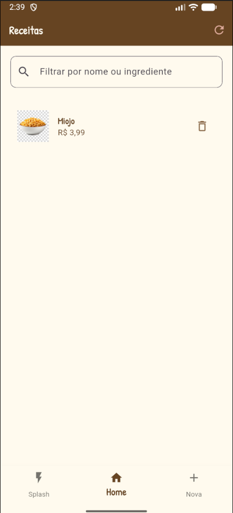
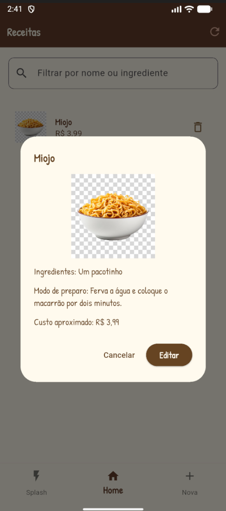
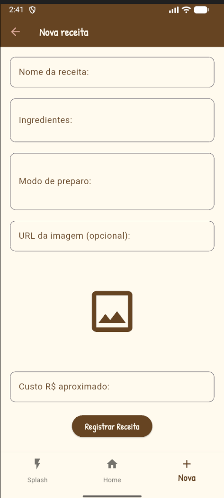

# Livro de Receitas

App Flutter para consultar, buscar, cadastrar, editar e excluir receitas. As informações são salvas em uma API própria publicada na Vercel.

**Backend:** [Backend-Receitas-Flutter](https://github.com/EnzoToniato567/Backend-Receitas-Flutter.git)

## Funcionalidades

- Lista de receitas com busca por nome ou ingrediente.
- Detalhes com ingredientes, modo de preparo, imagem e custo.
- Cadastro, edição e exclusão de receitas.
- Tema claro e escuro e tela inicial animada.

## Apk 

- O apk do app está em [flutter_receitas.apk](./flutter_receitas_api/assets/flutter_receitas.apk)

## Como executar

```bash
cd flutter_receitas_api
flutter pub get
flutter run
```

> Caso queira gerar o apk localmente, rode: 

```bash
flutter build apk --release
```

## Screenshots

<table>
  <tr>
    <th>Tela inicial</th>
    <th>Lista de receitas</th>
  </tr>
  <tr>
    <td align="center"></td>
    <td align="center"></td>
  </tr>
  <tr>
    <th>Detalhes da receita</th>
    <th>Nova receita</th>
  </tr>
  <tr>
    <td align="center"></td>
    <td align="center"></td>
  </tr>
</table>
